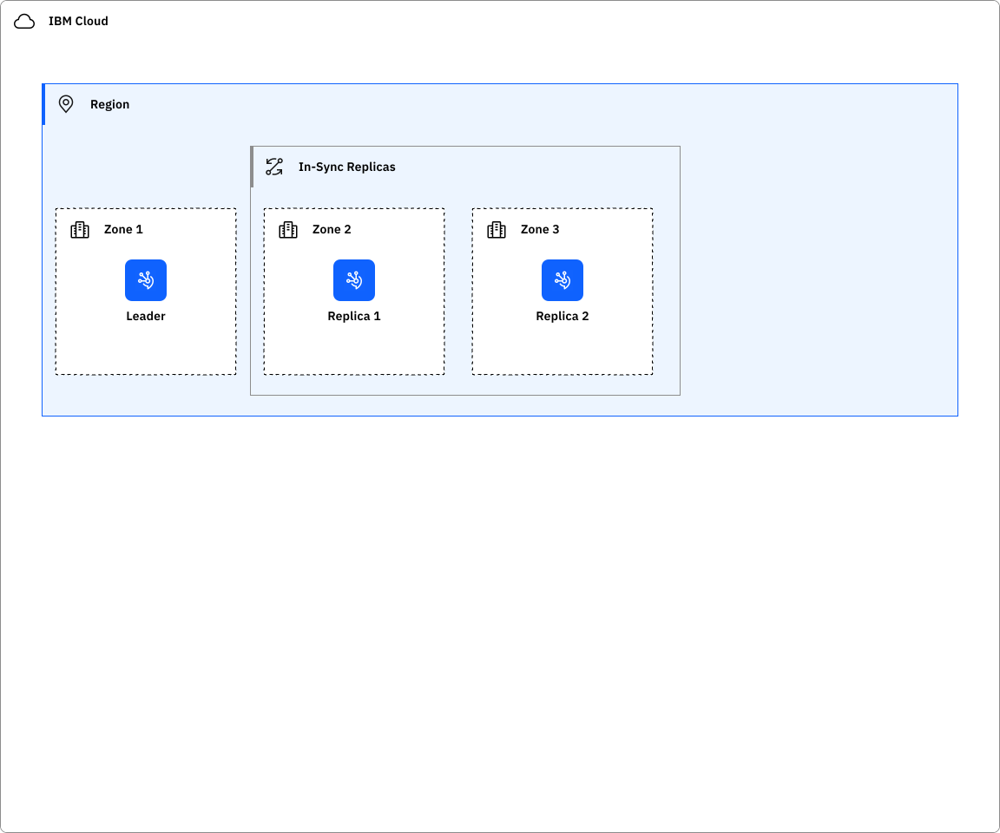
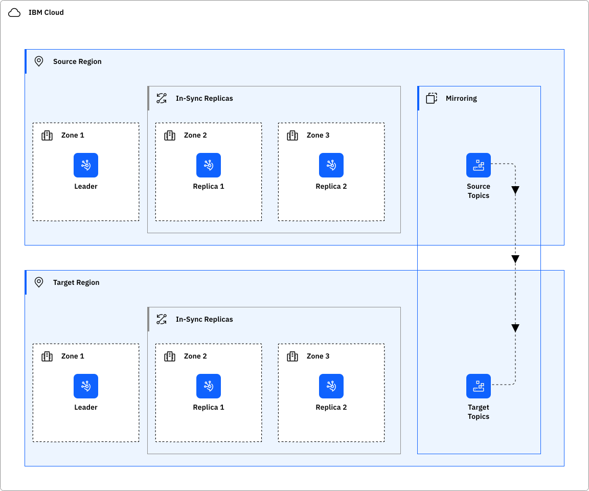

---

copyright:
  years: 2026
lastupdated: "2026-11-11"

keywords: HA for Event Streams, DR for Event Streams, Event Streams recovery time objective, high availability, disaster recovery

subcollection: EventStreams-gen2

---

{{site.data.keyword.attribute-definition-list}}

# Ensuring high availability and disaster recovery for {{site.data.keyword.cloud_notm}} {{site.data.keyword.messagehub}}
{: #eventstreams-ha-dr}

[Gen 2]{: tag-purple}

Learn about high availability and disaster recovery for {{site.data.keyword.messagehub}} on {{site.data.keyword.cloud}}, including architecture and features for maintaining service continuity.
{: shortdesc}

[High availability](#x2284708){: term} (HA) is the ability for a service to remain operational and accessible in the presence of unexpected failures. [Disaster recovery](#x2113280){: term} is the process of recovering the service instance to a working state.

{{site.data.keyword.messagehub_full}} is a global service, and you can find the available region and data center locations in the [Service and infrastructure availability by location](/docs/overview?topic=overview-services_region) documentation. As a global service, {{site.data.keyword.messagehub}} fulfills the defined [Service Level Objectives (SLO)](/docs/resiliency?topic=resiliency-slo) by using the Enterprise Gen 2 plans. The SLO is not a warranty, and {{site.data.keyword.IBM}} does not issue credits for failure to meet an objective.

## High availability architecture
{: #ha-architecture}

{: caption="{{site.data.keyword.messagehub}} high availability architecture" caption-side="bottom"}

### High availability features
{: #ha-features}

{{site.data.keyword.messagehub}} supports the following high availability features:

| Feature | Description | Consideration |
| -------------- | -------------- | -------------- |
| Multi-zone region deployment | Distributed across three availability zones for fault tolerance and high availability | In {{site.data.keyword.messagehub}}, the data of each partition is distributed across three availability zones (for MZR deployments) to ensure business continuity if you lose an availability zone. |
| Minimum in-sync replicas | {{site.data.keyword.messagehub}} requires a minimum of two in-sync replicas at all times | {{site.data.keyword.messagehub}} continuously monitors and ensures that at least two replicas are synchronized across availability zones. This process prevents message loss if a broker or zone fails, and it keeps critical data durable. |
{: caption="HA features for {{site.data.keyword.messagehub}}" caption-side="bottom"}

## Disaster recovery architecture
{: #disaster-recovery-intro}

{: caption="{{site.data.keyword.messagehub}} disaster recovery architecture" caption-side="bottom"}

| Feature | Description | Consideration |
| -------------- | -------------- | -------------- |
| Mirroring | Mirroring for cluster replication | {{site.data.keyword.messagehub}} Enterprose Gne2 initial release does not provide provides a mirroring feature, however a customer can choose to manager their own mirroring solution to enable messages to be continuously copied into a second instance. |
{: caption="DR features for {{site.data.keyword.messagehub}}" caption-side="bottom"}

-->

### Planning for disaster recovery
{: #features-for-disaster-recovery}

Practice the disaster recovery steps regularly. As you build your plan, consider the following failure scenarios and resolutions.

| Failure | Resolution |
| -------------- | -------------- |
| Hardware failure (single point) | {{site.data.keyword.messagehub}} is resilient to a single point of hardware failure within a zone. No configuration is required. |
| Zone failure | An {{site.data.keyword.messagehub}} instance that is deployed in a multi-zone region is resilient to the failure of a single zone. No configuration is required. |
| Data corruption | {{site.data.keyword.messagehub}} does not include any built-in mechanisms to recover from data corruption. You must plan for such circumstances as a part of a disaster recovery plan. You might need to use a mirroring feature or configure a new instance. |
| Regional failure | If you configured your {{site.data.keyword.messagehub}} instance in a multi-zone region, a regional disaster is unlikely. If a regional failure does occur, you must configure a new instance in another region. For more information, see [Understanding your responsibilities](/docs/EventStreams-gen2?topic=EventStreams-gen2-event_streams_responsibilities). |
{: caption="Disaster recovery scenarios for {{site.data.keyword.messagehub}}" caption-side="bottom"}

## Change management
{: #change-management}

Understand the management responsibilities and terms and conditions that apply when you use {{site.data.keyword.messagehub}}. Use the [customer responsibilities](/docs/EventStreams-gen2?topic=EventStreams-gen2-event_streams_responsibilities) page as a starting point to create a plan for high availability and disaster recovery.

As part of disaster recovery, grant users and processes the IAM roles and actions with the least privilege required for their work. For more information, see [How can I prevent accidental deletion of services?](/docs/resiliency?topic=resiliency-dr-faq#prevent-accidental-deletion).

All {{site.data.keyword.messagehub}} plans can recover a deleted instance within a reclamation period of three days, after which the data is irreversibly destroyed. You can check the status of a reclamation, and force or cancel a scheduled reclamation by using the [{{site.data.keyword.cloud_notm}} CLI](/docs/cli?topic=cli-ibmcloud_commands_resource#ibmcloud_resource_reclamations).

If {{site.data.keyword.messagehub}} can’t restore the service instance, you must restore as described in [Mirroring in a disaster recovery scenario](/docs/EventStreams?topic=EventStreams-disaster_recovery_scenario).

## How {{site.data.keyword.IBM_notm}} maintains services
{: #ibm-service-maintenance}

All upgrades follow the {{site.data.keyword.IBM_notm}} service best practices and have a recovery plan and rollback process in place. Regular upgrades for new features and maintenance occur as part of normal operations. Such maintenance can occasionally cause short interruption intervals that [client availability retry logic](/docs/resiliency?topic=resiliency-high-availability-design#client-retry-logic-for-ha) handles. IBM rolls out changes sequentially, region by region and zone by zone within a region. IBM backs out updates at the first sign of a defect.

IBM enables and disables complex changes with feature flags to control exposure.

Notifications describe changes that impact customer workloads. For more information, see [monitoring notifications and status](/docs/support?topic=support-viewing-status) for planned maintenance, announcements, and [release notes](/docs/EventStreams-gen2?topic=EventStreams-gen2-event-streams-relnotes-gen2) that impact {{site.data.keyword.messagehub}}.
